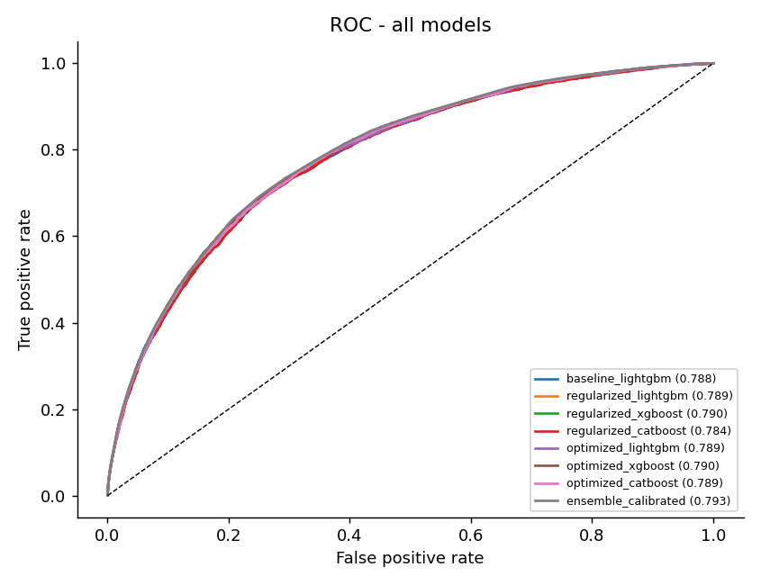
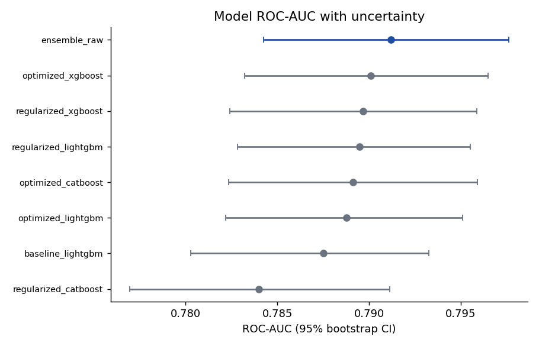
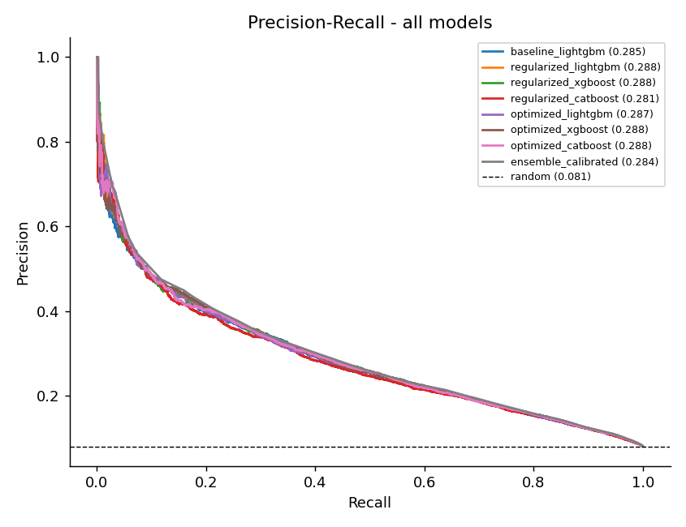
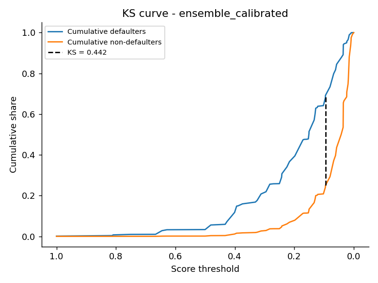
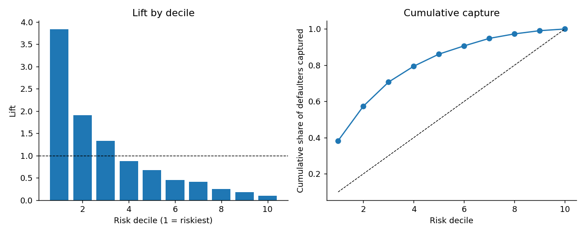
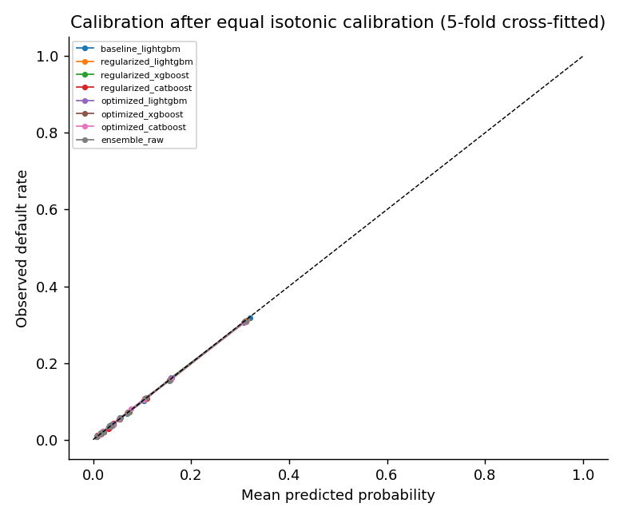
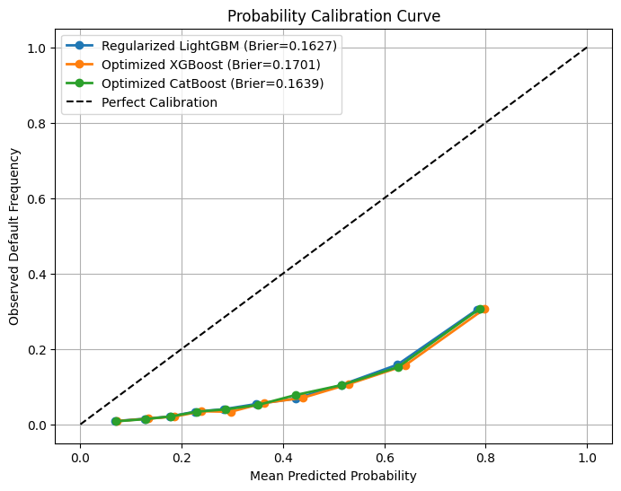
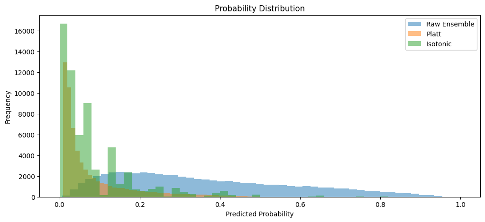
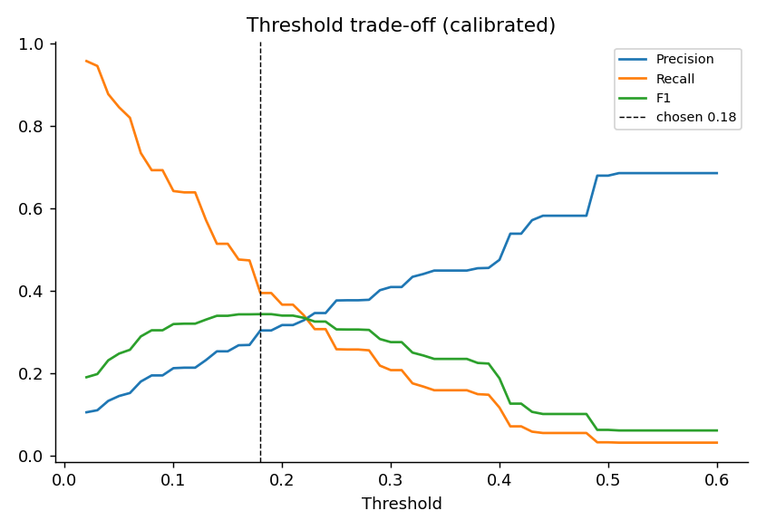
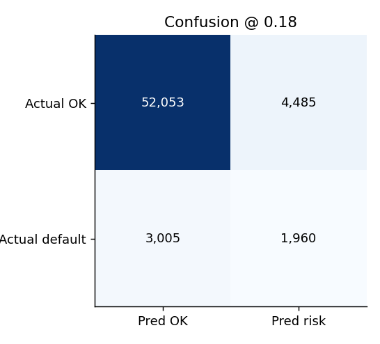

# CreditLens-AI model card

## Summary
A credit-default risk model built on the public **Home Credit Default
Risk** dataset. It estimates the probability that an applicant will have
payment difficulties and flags applicants for analyst review. It is a
decision-support **prototype for a portfolio**, not a lending product.

## Data
Home Credit application records joined with credit-bureau,
bureau-balance, previous-application, POS-cash, instalment and
credit-card history tables, giving 297 model features. The data comes
from a different lender and population than any real deployment would
serve. Roughly 1 in 12 applicants defaults, so the classes are imbalanced.

## Model
* Weighted ensemble: LightGBM 0.35, XGBoost 0.35, CatBoost 0.30.
* Isotonic calibration of the ensemble score (raw scores run far above
  real default rates; calibration maps them to observed frequencies).
* Decision threshold 0.18 on the **calibrated** probability, chosen to
  maximise F1 on calibrated probabilities (equivalent to a raw ensemble
  threshold of 0.69).
* Explanations: SHAP evidence per model, plus an AI-written summary that
  explains, and never changes, the decision.

## Measured performance
Split: 246,008 training and 61,503 validation customers; 8.07% positives;
297 features. All figures below were recomputed from the saved model files without
retraining (`scripts/compare_models_colab.py`); outputs are in
`docs/model_comparison_full.csv` and `docs/model_calibration_fair.csv`.

### Ranking quality (validation set)

| Model | ROC-AUC | Gini | KS | PR-AUC | Top-decile lift | Top-30% capture |
|---|:---:|:---:|:---:|:---:|:---:|:---:|
| **Ensemble, calibrated (production)** | **0.7926** | **0.585** | **0.442** | 0.284 | 3.83x | 70.7% |
| Ensemble, raw | 0.7912 | 0.582 | 0.442 | 0.291 | 3.82x | 70.4% |
| XGBoost (optimized) | 0.7901 | 0.580 | 0.441 | 0.288 | 3.79x | 70.4% |
| XGBoost (regularized) | 0.7897 | 0.579 | 0.439 | 0.288 | 3.79x | 70.2% |
| LightGBM (regularized) | 0.7895 | 0.579 | 0.441 | 0.288 | 3.78x | 70.3% |
| CatBoost (optimized) | 0.7891 | 0.578 | 0.434 | 0.288 | 3.79x | 69.6% |
| LightGBM (optimized) | 0.7888 | 0.578 | 0.439 | 0.287 | 3.75x | 70.1% |
| LightGBM (baseline) | 0.7875 | 0.575 | 0.437 | 0.285 | 3.77x | 70.1% |
| CatBoost (regularized) | 0.7840 | 0.568 | 0.432 | 0.281 | 3.70x | 69.7% |

PR-AUC of a random model: 0.081. Train ROC-AUC of the raw ensemble is 0.8727
(gap 0.082), so the models overfit somewhat. Calibration (a monotone transform)
does not change ranking metrics such as KS, Gini or lift.

### Model selection
The models are statistically tied. ROC-AUC has a 95% bootstrap interval of about
+/-0.007 (about 5,000 defaulters in validation) and all intervals overlap almost
completely. Pairwise rank correlation between the individual models is 0.95-0.99, so
they are largely redundant: all are gradient-boosted trees on the same 297 features,
and the limit is the information in the data rather than the algorithm. The ensemble
was kept for stability, calibration, a "models agreeing" signal and SHAP evidence
across three models, not because of a large accuracy gain (+0.005 AUC over the
baseline LightGBM, +0.0025 over the best single model).

### Calibration
| Calibration of the ensemble | Brier score |
|---|:---:|
| Constant prediction at the default rate (baseline) | 0.0742 |
| Raw ensemble | 0.1650 |
| Platt scaling | 0.0657 |
| Isotonic (production) | 0.0653 |

Fair comparison: every model calibrated the same way (isotonic regression, 5-fold
cross-fitted so each probability is out-of-sample).

| Model | Brier (raw) | Brier (calibrated) | ECE (calibrated) |
|---|:---:|:---:|:---:|
| Ensemble | 0.1650 | 0.0655 | 0.0013 |
| XGBoost (regularized) | 0.1762 | 0.0656 | 0.0012 |
| XGBoost (optimized) | 0.1701 | 0.0657 | 0.0012 |
| CatBoost (optimized) | 0.1639 | 0.0657 | 0.0014 |
| LightGBM (regularized) | 0.1627 | 0.0657 | 0.0017 |
| LightGBM (optimized) | 0.1416 | 0.0657 | 0.0011 |
| LightGBM (baseline) | 0.1615 | 0.0658 | 0.0021 |
| CatBoost (regularized) | 0.1829 | 0.0660 | 0.0013 |

Single-model raw Brier and ECE are not comparable with the calibrated ensemble:
those models were trained with class weighting and are not probability-calibrated.
After equal calibration all models are almost identical. The production calibrator
(fitted on the full validation set) gives Brier 0.0653; cross-fitting gives 0.0655.

The isotonic output is a step function, so many customers share identical
calibrated probabilities (the spikes in the distribution plot).

### Operating point (threshold 0.18, calibrated)
Precision 0.304, recall 0.395, F1 0.344; 6,445 of 61,503 customers flagged
(10.5%); TN 52,053, FP 4,485, FN 3,005, TP 1,960. Accuracy (0.878) is not
informative: about 92% of customers do not default.

**Evaluation caveat (from the saved results).** The validation set was used
during model development, and the isotonic calibrator and the 0.18 threshold
were fitted and optimised on that same set. The calibrated metrics are
therefore **not an independent final test**.

## Audit record
Every assessment is stored in PostgreSQL with the decision, calibrated and raw
probability, threshold, model version, ensemble weights, input completeness, SHAP
base value, the top SHAP factors and the explanation shown. Predictions do not
depend on the database; it exists so a past decision can be reviewed and traced to
the configuration that produced it.

## Intended use
Demonstrating an explainable, calibrated credit-risk workflow on public
data: assessing customers from the dataset, viewing the evidence, saving
an audit trail of each decision.

## Out of scope
Real lending, collections or any decision affecting a real person.

## Known limitations
* The model variants are statistically indistinguishable on this data (see Model
  selection); further tuning is unlikely to help, better features might.
* Public data from another lender; no validation on any real portfolio,
  no time-based test, no drift monitoring.
* The strongest inputs are anonymised external credit scores that a real
  lender would have to replace.
* **Gender (`CODE_GENDER`) is an input of the trained model.** The column
  comes with the dataset, and keeping it was a modelling choice. Many
  jurisdictions restrict using it in credit decisions. The audit `python scripts\evaluate_gender_impact.py` measured its effect on a
  40,000-customer sample of the training file (so figures are in-sample):
  neutralising gender changes ROC-AUC only from 0.857 to 0.853, but it
  changes who is flagged at 0.18 (men 15.5% with gender, 11.6% without;
  women 8.4% either way). Men's actual default rate in the sample is 10.3%
  against 7.0% for women. Dropping the input at the next retrain is
  recommended; neutralising is not the same as retraining. No fairness
  audit beyond this check has been done.
* Tree models do not extrapolate: an extreme input value behaves like the
  largest value seen in training, so the model should only be run on
  records that resemble the dataset. The app therefore assesses customers
  from the dataset only and does not accept hand-typed applicants.
* When the AI-explanation service is unavailable, the backend still
  returns the prediction, decision and SHAP evidence, with a notice in
  place of the written summary.
