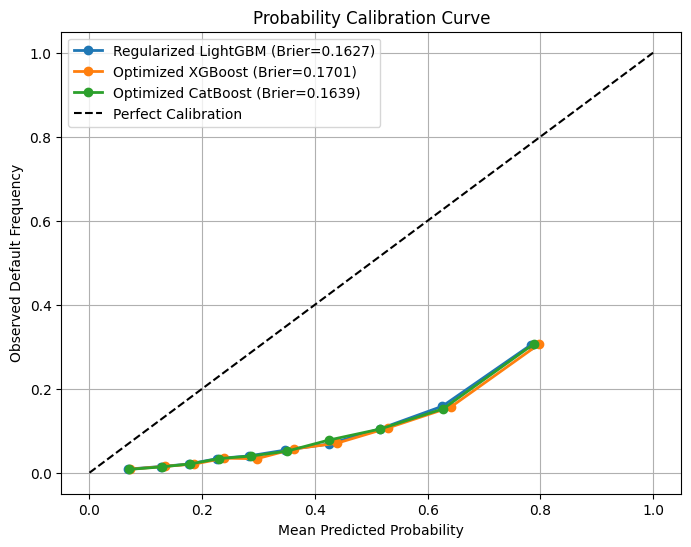
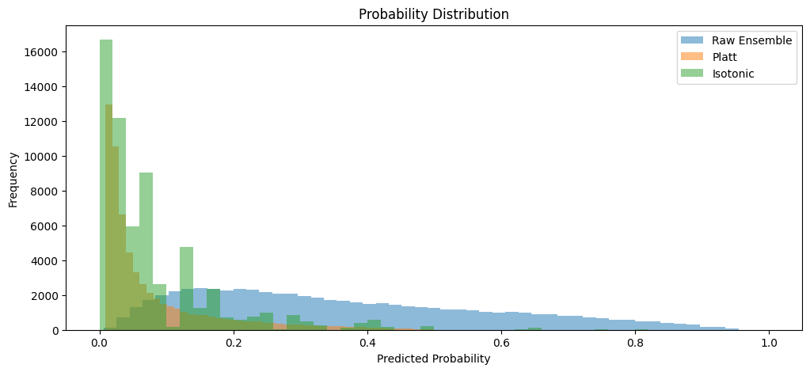

# CreditLens-AI model card

## Summary
A credit-default risk model built on the public **Home Credit Default
Risk** dataset. It estimates the probability that an applicant will have
payment difficulties and flags applicants for analyst review. It is a
decision-support **prototype for a portfolio**, not a lending product.

## Data
Home Credit application records joined with credit-bureau,
bureau-balance, previous-application, POS-cash, instalment and
credit-card history tables, giving 297 model features. The data comes
from a different lender and population than any real deployment would
serve. Roughly 1 in 12 applicants defaults, so the classes are imbalanced.

## Model
* Weighted ensemble: LightGBM 0.35, XGBoost 0.35, CatBoost 0.30.
* Isotonic calibration of the ensemble score (raw scores run far above
  real default rates; calibration maps them to observed frequencies).
* Decision threshold 0.18 on the **calibrated** probability, chosen to
  maximise F1 on calibrated probabilities (equivalent to a raw ensemble
  threshold of 0.69).
* Explanations: SHAP evidence per model, plus an AI-written summary that
  explains, and never changes, the decision.

## Measured performance
Source: the project's development-validation results (`models/calibration_results.json`
and the model comparison table). Split: 246,008 training and 61,503 validation
customers; 8.07% positives; 297 features.

| Model | Train ROC-AUC | Validation ROC-AUC | Validation PR-AUC |
|---|:---:|:---:|:---:|
| Weighted ensemble (raw) | 0.8727 | 0.7912 | 0.2907 |
| Weighted ensemble (calibrated) | - | 0.7926 | 0.2843 |
| XGBoost | 0.8533 | 0.7901 | 0.2883 |
| LightGBM | 0.8811 | 0.7895 | 0.2883 |
| CatBoost | 0.8788 | 0.7891 | 0.2878 |

| Calibration | Brier score |
|---|:---:|
| Constant prediction at the default rate (baseline) | 0.0742 |
| Raw ensemble | 0.1650 |
| Platt scaling | 0.0657 |
| Isotonic (production) | 0.0653 |

At threshold 0.18 (calibrated): precision 0.304, recall 0.395, F1 0.344;
6,445 of 61,503 customers flagged (10.5%); TN 52,053, FP 4,485, FN 3,005,
TP 1,960. Accuracy (0.878) is not informative: about 92% of customers do not
default.

**Evaluation caveat (from the saved results).** The validation set was used
during model development, and the isotonic calibrator and the 0.18 threshold
were fitted and optimised on that same set. The calibrated metrics are
therefore **not an independent final test**. Train AUC (0.85-0.88) is well
above validation AUC (0.79), so the models overfit somewhat.

The isotonic output is a step function, so many customers share identical
calibrated probabilities (the spikes in the distribution plot).

## Intended use
Demonstrating an explainable, calibrated credit-risk workflow on public
data: assessing customers from the dataset, viewing the evidence, saving
an audit trail.

## Out of scope
Real lending, collections or any decision affecting a real person.

## Known limitations
* Public data from another lender; no validation on any real portfolio,
  no time-based test, no drift monitoring.
* The strongest inputs are anonymised external credit scores that a real
  lender would have to replace.
* **Gender (`CODE_GENDER`) is an input of the trained model.** The column
  comes with the dataset, and keeping it was a modelling choice. Many
  jurisdictions restrict using it in credit decisions. The audit `python scripts\evaluate_gender_impact.py` measured its effect on a
  40,000-customer sample of the training file (so figures are in-sample):
  neutralising gender changes ROC-AUC only from 0.857 to 0.853, but it
  changes who is flagged at 0.18 (men 15.5% with gender, 11.6% without;
  women 8.4% either way). Men's actual default rate in the sample is 10.3%
  against 7.0% for women. Dropping the input at the next retrain is
  recommended; neutralising is not the same as retraining. No fairness
  audit beyond this check has been done.
* Tree models do not extrapolate: an extreme input value behaves like the
  largest value seen in training, so the model should only be run on
  records that resemble the dataset. The app therefore assesses customers
  from the dataset only and does not accept hand-typed applicants.
* When the AI-explanation service is unavailable, the backend still
  returns the prediction, decision and SHAP evidence, with a notice in
  place of the written summary.
